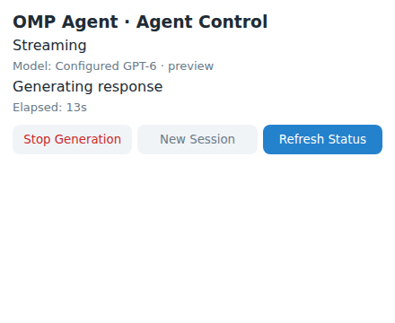
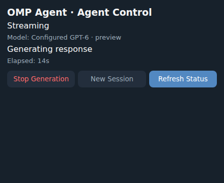

# Acceptance procedure

Use this checklist for a real owner-only deployment. Record the deployed commit,
date, actual provider/model identifier, Telegram client version, and **passed,
failed, or not executed** for each item in the release/PR evidence. Never record
secrets, private transcripts, or unredacted user identifiers. Mocked transport tests
and a passing image build do not satisfy live acceptance.

## Automated gates

Integrated verification on **2026-11-10**, Bun **1.4.4**:

- `bun test`: **77 passed, 0 failed, 363 assertions across 7 files**
- `bun run typecheck`: passed
- `git diff --check`: passed
- Real OMP SDK sessions, metadata/transcript restart restoration, isolated registries,
  official events and cancellation: passed with a **simulated provider transport**
- Telegram routing, drafts, explicit 429 backoff, rich fallback, widget authorization,
  guest isolation, ephemeral callback payloads and webhook authentication: passed
  with a **simulated Telegram transport**
- One-time `/stast` ownership: atomic claims, persisted ownership after restart,
  schema-v1 upgrade, configured-owner reservation, conflicting-config rejection,
  private-only claiming and all authorized control surfaces passed with simulated transport
- Bot-owned catalog diagnostics: no authenticated models; expected explicit GPT-6
  setup error, no substitute selected
- Railway CLI 5.71.0: installed and invoked; status returned **Unauthorized**
- Local Docker build: not executed (no daemon in this sandbox); CI build is tracked
  separately on the pull request

The user selected **code and PR only** for this handoff. No Railway resources were
provisioned, and deployment is intentionally deferred. All live checks below
remain not executed, independently of passing local tests.

### Widget preview evidence

Fresh screenshots of the actual self-contained widget HTML were captured and
inspected in headless Chrome with a **simulated Telegram bridge** and synthetic
status/model labels. Light/dark palette and disabled/available control appearance
were checked. The runtime behavior test exercises request loading, action data,
response parsing and revision reconciliation. This is **not** a Telegram QuickJS
or live client verification; native widget acceptance remains pending.




```sh
sh .hoplite/setup.sh
export PATH="$PWD/.tools/bun-linux-x64:$PATH"
bun run typecheck
bun test
docker build -t telegram-omp-agent:verification .
```

Record the actual test totals from that run, not a historical number. On a machine
without a Docker daemon, leave image-build verification pending for CI rather
than claiming a build from static Dockerfile review. CI is defined in
`.github/workflows/check.yml`; a workflow definition is not evidence it ran.

## Required live checks

Application startup itself performs one small billable GPT-6 probe before
readiness, then initializes Telegram and registers/verifies the webhook. Successful
startup must not be inferred from mocked tests or model catalog diagnostics. Run
`bun scripts/models.ts` for bot-owned credential/model diagnostics when startup
fails; the production image includes it.

Every row requires real credentials, an approved running Railway service, and/or
a compatible Telegram client. No live completion is asserted by this document. The initial status below reflects
missing Telegram, Railway, and OpenAI credentials in the development runtime.

| # | Exercise | Pass evidence | Status |
| --- | --- | --- | --- |
| 1 | Send a private message as the owner | One actual OMP response; unauthorized users rejected | Not executed |
| 2 | Use `/model` and verify deployed runtime authentication | Actual authenticated GPT-6 provider/model, not a guessed ID or alternate model | Not executed |
| 3 | Ask for a long response | Visible thinking placeholder, throttled native draft streaming, persistent final response | Not executed |
| 4 | Stop an active generation natively, via `/stop`, and via widget | Correct turn cancelled in OMP; no late draft updates; another conversation unaffected | Not executed |
| 5 | Ask the model for headings, a table, code, links, lists, quotes and a divider | Readable Rich Message generated from real model output; long response split safely | Not executed |
| 6 | Open `/widget`; Refresh, Stop, New Session; test light/dark themes | Correct loading/error/disabled states and reconciled model/status; unauthorized action denied | Not executed |
| 7 | Enable BotFather Guest Mode and `GUEST_ACCESS_MODE=owner`; mention bot in eligible external chat | Exactly one guest answer; no private history or widgets; referenced context only when supplied | Not executed |
| 8 | Trigger a callback control/status action | Query answered within deadline; ephemeral detail visible only to triggering user | Not executed |
| 9 | Restart Railway during generation | Graceful cancellation or interrupted state, no auto-resume or duplicate final delivery | Not executed |
| 10 | After a completed conversation, restart and continue as the same user/topic | Previous context retained through native OMP session restoration | Not executed |
| 11 | Redeploy same service and verify webhook, volume, and restored context | Same `/data` mapping, one replica, correct webhook URL/allowed updates, no webhook errors | Not executed |

For widget appearance, capture fresh light/dark screenshots and inspect them.
For behavior, inspect a fresh interaction recording or perform direct checks.
Redact or recapture any private content before attaching evidence. A screenshot
alone does not prove cancellation or server-side authorization.

## Additional reliability checks

- With `ADMIN_USER_ID` blank and a fresh owner record, send `/stast` privately as
  the intended owner, then try another user. Confirm only the first owns the bot,
  normal messages before claiming cannot generate, and group/guest/bot-account
  claims are ignored. Restart with the same volume and confirm ownership remains.
  A configured owner must be reserved before any incoming claim; a conflicting
  environment owner must fail startup. These live checks remain **not executed**.


- `GET /health` and `GET /ready` return expected liveness/readiness; no token or
  transcript appears in their bodies. Requests with a missing or incorrect webhook
  secret are rejected, and a correctly authenticated update is durably accepted.
- Confirm `/new`, confirmed `/reset`, and widget New Session detach the active
  transcript without erasing retained files; expired reset confirmations must fail.
- Redelivering the same update does not create a second generation or final reply.
- Use two authorized identities/topics to confirm histories and stop controls do
  not cross. Send two requests in one conversation and confirm explicit busy behavior.
- Verify the actual OMP session has no shell/filesystem/browser/Git/MCP/extension
  tools. A package being present in the image must not grant tools.
- In an isolated disposable copy of a stopped-writer backup, corrupt or remove
  one referenced session file. Confirm explicit recovery error, never another
  user's session, and preserve the original backup. Do not corrupt production.
- Rehearse coherent backup and restore as documented in `docs/persistence.md`;
  restore the database and OMP data together and confirm the original context.
- Exercise 429 retry behavior in automated tests. Do not intentionally flood
  Telegram or the provider to manufacture live rate limits.
- Confirm public access remains disabled until rate limits, allowed users,
  spending controls, and the complete live checklist are reviewed.

## Blocker resolution

Configure `TELEGRAM_BOT_TOKEN`, a fresh `TELEGRAM_WEBHOOK_SECRET`, the verified
provider credential (for OpenAI, `OPENAI_API_KEY`) as runtime variables. Reserve
`ADMIN_USER_ID` explicitly or leave it blank and claim once with `/stast` in the
private chat. Rotate any disclosed bot token through BotFather before testing. Supply an authenticated Railway account/token through its approved
secret mechanism and approve the service/volume cost before provisioning. A
Railway token is a deployment credential, not an application environment variable.
The selected provider account must independently offer GPT-6 in the deployed
OMP model registry. If any prerequisite is absent, mark affected checks **not
executed**, state the exact missing prerequisite, and do not claim deployment or
integration success. BotFather/client restrictions may separately block guest,
widget, stop-generation, or ephemeral verification even with a valid bot token.
